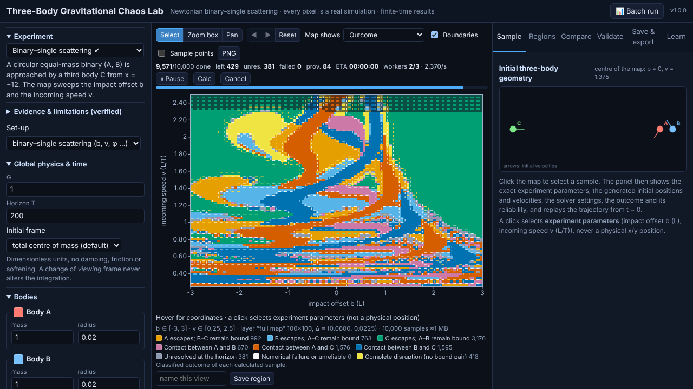

# Three-Body Gravitational Chaos Lab

A laboratory for **Newtonian three-body scattering**. A third body (C) approaches a
binary (A, B). The big map in the middle has one pixel per experiment (impact offset
*b* across, incoming speed *v* up) and **every coloured pixel is a real numerical
simulation**: nothing is drawn from a formula or interpolated. Pick a pixel to replay
its trajectory, zoom to run new simulations at finer scale, let the lab refine the
boundaries, compare neighbouring encounters, check numerical confidence, edit the
physics, save, resume and export.

For A level Physics students and advanced learners (WJEC / GCSE / iGCSE teaching repo).
Results are **finite-time numerical observations**, never proofs of stability or of
mathematical chaos.



*(The default 100 × 100 outcome map; every pixel is a real simulation. More views: `docs/screenshot-compare.png`, `docs/screenshot-tablet.png`.)*

## Run it

| How | Steps |
|---|---|
| **Easiest** | Open `three-body-chaos.html` in **Chrome or Edge** (no install, no internet; one self-contained file, workers and storage included). |
| **Windows launcher (local HTTP)** | Double-click `Start-Lab.cmd`. It serves the build at http://127.0.0.1:4173/ using Node.js (no `npm install` needed) and opens the browser. Falls back to opening the file if Node is missing. Keep the window open while you work. |
| **Any static server** | `node source/scripts/serve.mjs` (set `PORT=4180` to change the port). |

Saved investigations (IndexedDB) belong to the browser profile **and** the address
(file path or `http://127.0.0.1:port`), so use the same way of opening it to find them again;
downloaded investigation files work everywhere.

## Develop

Needs Node.js 22.18 or newer. From `source/`:

```
npm install            # react, vite, typescript (lockfile included: npm ci also works)
npm run dev            # Vite dev server on http://127.0.0.1:5173
npm run build          # type-check, bundle, then write ../three-body-chaos.html (single file)
npm test               # unit + engine + build tests (node:test, ~25 s)
npm run browser-check  # real-Chromium acceptance suite, desktop and tablet (see below)
npm run benchmark      # single-thread throughput, writes ../BENCHMARK.json
npm run example        # rebuilds ../examples/example-investigation.tbcl.json.gz
npm run package        # rebuilds ../three-body-chaos-lab.zip (source + build, no node_modules)
```

`npm run browser-check` needs Playwright and Chromium
(`npm install --no-save playwright && npx playwright install chromium`).
Rebuild the HTML after any source change and re-run `tools/worksheets` for this
simulation if the batch experiments changed.

## A tour (the acceptance flow)

1. **Open the lab.** The initial three-body geometry is drawn on the right (Sample tab) and in the left panel
   (*Initial geometry*, with an optional *Place body* editor); a coarse map starts calculating immediately (coarse lattice first, then every cell of the 100 × 100 grid).
   Completed samples can be inspected while calculation continues. Uncalculated areas are hatched;
   dimmed pixels are only a *preview* from a coarser sample.
2. **Click a pixel.** The Sample tab shows the exact *b* and *v*, the generated initial positions and
   velocities, solver settings, outcome, status (not calculated / unresolved / provisional / classified /
   failed) and reliability. The trajectory replays from t = 0 (play, step, scrub, trails, centre-of-mass
   or body tracking, vectors, conservation diagnostics, graphs). A map click never moves a body.
3. **Find boundaries.** Boundary overlay is on by default (white = different outcome, magenta =
   collision↔ejection, yellow = sharp change in event time, green = sharp change in closest approach,
   red = numerical). The **Regions** tab ranks blocks of *computed* samples with a documented score and
   lists them separately from regions that need numerical validation.
4. **Refine.** **Auto-Explore Boundaries** (Regions tab) runs real simulations at the centres of new
   quadtree cells around boundaries, plus seeded stratified supplementary samples that can reveal islands.
   Depth, budget, minimum scales, priorities, seed, pause / resume / cancel are all adjustable. Zooming
   (rectangle, wheel, pinch, double-click, history, saved regions) always computes a **new layer** at the
   finer sampling scale.
5. **Compare.** *Compare Both Sides* takes two actual neighbouring samples with different outcomes;
   *Compare perturbed* changes one chosen parameter by an exact amount. Trajectories are overlaid or
   side by side, compared at common physical times, with graphs of distances, conservation residuals,
   speeds, binary energy, momentum/COM and the scaled phase-space separation.
6. **Check confidence.** Validate re-runs boundary samples at the baseline, 10× and 100× tighter tolerances and
   records agreement categories separately. On a sample, *Compare with independent reference solver* runs a
   Bulirsch–Stoer integrator and reports actual differences.
7. **Edit physics.** Left panel: masses, radii, G, horizon, positions and velocities (explicit set-up), binary
   separation, eccentricity, phase, tolerances. Edits are **pending** until *Apply*; applying discards
   incompatible results (a configuration seen before is restored from the cache). Colours change instantly and
   touch nothing else.
8. **Save, resume, export.** Save & export tab: IndexedDB saves (with real transaction status), portable
   gzip investigation files, autosave recovery, and PNG / CSV / JSON exports.

**📊 Batch run** (header): four one-click experiments (outcome-fraction scatter, energy error vs tolerance,
fast fly-by energy transfer, outcome sensitivity to tiny changes in *b*) that run many real simulations headlessly
and compare with theory using mean, SD and standard error, with CSV download. The window has the set-up on the left and
the results on the right (▶ Run batch at the top, visible without scrolling at 1280×720). Choose what to **Record**, and the
**starting settings table** lists every starting setting of the binary–single scattering set-up that outcome uses (G,
masses, radii, A–B separation, eccentricity, C's starting x, horizon, rtol and rtol ÷ atol, the frame, the ranges b, v and φ
are drawn from, or the fixed b, v, φ and nudge δ). Edit any value; tick one to sweep it from → to in steps (+ or ×); **↺ Use
my left-panel settings** copies the left panel. Theory lines are drawn only where the theory applies (error ∝ rtol when rtol
is swept, ∝ 1/v when v is swept, → 1 for the nudge test). Printable worksheets are in `worksheets.html`.

**Screen layout.** The header's **◧ Hide controls**, **Hide readouts ◨** and **⛶ Full screen** buttons (keys `[`, `]`, `F`)
hide the settings and inspector panels or show only the map; the ⋮ bars between the panels drag to resize them
(double-click resets), and the layout is remembered in the browser. This is the same view bar as every other simulation in
the repository: `source/viewbar.html` is a copy of the shared block, added to the built file by `scripts/inline-build.mjs`
(so it is missing from `npm run dev`). There is **no picture-quality setting**, on purpose: almost all the time goes on the
simulations, and the map is painted from the real results at screen resolution, so the left panel (Compute budget) explains
this and points to the worker count and map resolution instead.

## Physical model

* Planar, full mutual Newtonian gravity: **a_i = G Σ_{j≠i} m_j (r_j − r_i)/|r_j − r_i|³**. All three bodies interact.
* Dimensionless units, G = 1 (lengths L, masses M, time T = √(L³/GM)). No damping, friction, drag, relativity or softening.
* Bodies are point masses with a **contact radius**; the run stops at the first located contact and records the pair.
  Radius 0 means a true point mass: encounters closer than 10⁻⁸ of the reference length are reported as a *singular failure*.
* Default experiment (as briefed): G = 1, masses 1, circular A–B binary of separation 1 (A at (−0.5, 0), v = (0, −√½); B at (+0.5, 0),
  v = (0, +√½)), C at (−12, *b*) with velocity (*v*, 0), radii 0.02, horizon 200, then **transformed to the total centre-of-mass
  frame**. Map: *b* ∈ [−3, 3], *v* ∈ [0.25, 2.5], 100 × 100. *v* is C's speed at the finite start distance, **not** its speed at infinity.
* Binary construction is derived for any masses: v_rel = √(G(m_A+m_B)(1+e)/r_p), shared in inverse proportion to the masses,
  started at pericentre; the phase φ rotates positions and velocities together; motion is counter-clockwise.
* Reference frames: viewing in the centre-of-mass frame or as integrated never changes the integration. The initial state can be
  built in the centre-of-mass frame (default) or the binary rest frame, and an explicit set-up can be transformed to the centre of mass.

### Numerics

* **Integrator:** Dormand–Prince **DOP853** (order 8, embedded 5th/3rd-order error estimate, 7th-order dense output),
  coefficients generated from SciPy's table. Defaults rtol 1e-9, atol 1e-11, max 200,000 steps/trajectory. Float64 throughout for coordinates, times and the integration itself; per-sample diagnostics (closest approach, energy error, exchange, onset, sensitivity) are stored as Float32.
  Steps are also capped to half the time-to-contact of any closing pair, and to a horizon-independent maximum, so the step
  sequence depends only on the initial condition and tolerances.
* **Collisions:** every step is tested with a cubic-Hermite gate for the closest approach *inside* the step; candidates are confirmed and
  located (bisection to ~10⁻¹⁵ of the step) on the dense output. A fast fly-through cannot be skipped by two outside end points.
* **Conservation:** monitored every step, never corrected. Scaled errors |ΔE|/S_E, |ΔP|/S_P, |ΔL|/S_L with
  S_E = K₀ + |U₀|, S_P = √(M S_E), S_L = M R₀ √(S_E/M), so they stay finite when E, P or L ≈ 0. Scaled energy error above 10⁻⁶ makes a
  result *provisional*; above 10⁻³ it is *unreliable* (both adjustable).
* **Horizon:** integration ends at the first accepted step at or after the horizon (reported time can exceed it by at most a few time units),
  which is what makes continuation bitwise-exact.

### Outcome classification

| Code | Outcome |
|---|---|
| 0, 1, 2 | A / B / C escapes; the other two remain bound |
| 3, 4, 5 | Contact A–B / A–C / B–C |
| 6 | Unresolved at the horizon |
| 7 | Numerical failure or unreliable (step underflow, work limit, non-finite, singular encounter, invalid start, conservation error) |
| 8 | Complete disruption: all pairs unbound and separating |

**Escape** needs *all* of: the surviving pair is bound; the escaper's energy relative to that pair's centre of mass is positive and its
radial velocity outward; its distance ≥ 5 × the pair's apocentre; and the conditions hold continuously for max(1, 1 pair period)
time units (all adjustable). *Acceptance time* (end of the run) and the *estimated onset* (start of the final continuous streak,
resolved to one step) are kept separate. A candidate still pending at the horizon is **provisional**. "Unresolved" is not
stability: hierarchical or long-lived states are finite-time observations.

### Map modes (units, normalisation, missing data)

Outcome · time to accepted escape (T; missing for non-escapes/pending) · collision time (T) · closest approach (log₁₀ L) ·
significant close encounters (count; a pair closer than 0.25 L counts once until it separates beyond 0.5 L) · survival time (T;
unresolved is censored at the horizon) · finite-time sensitivity (1/T, ln(Δ(T*)/Δ₀)/T* for a partner offset 10⁻⁷ of the x span; **not a
Lyapunov exponent**; computed on demand) · binary energy exchange ((E_final − E_initial)/|E_initial| of the surviving binary at acceptance;
includes a small tidal term of order (a/R)³) · boundary complexity (fraction of neighbours with a different outcome) · numerical reliability ·
sampling density (quadtree depth). *Missing data are shown dark grey; uncalculated cells are hatched.*

### Sampling conventions

Uniform samples sit at **pixel centres**, x_i = x₀ + (i+½)Δx, y_j = y₀ + (j+½)Δy, with *y increasing upward*. Adaptive cells are quadtree
children whose four *new* centres are simulated; a filled cell is a display footprint of its single sample, never a claim that every
pixel inside was calculated. Supplementary samples are free-standing points. Warnings appear when neighbouring coordinates approach
Float64 resolution, when spacing falls below ~10⁴ × the tolerance, or when it is finer than a spacing where validation already disagreed.

## Persistence, reproducibility, scheduling

* IndexedDB autosave (≈ every 20 s while working and on completion), named saves, recovery banner on start-up. Every save reports whether its
  transaction **completed**, errored or aborted.
* Portable file: `.tbcl.json.gz` (schema 1) holds configuration, all samples and diagnostics, quadtree topology, unresolved checkpoints (with
  escape-persistence counters and close-encounter hysteresis state), validation records, selection, view and history, saved regions,
  exploration settings and appearance. Import checks schema, model version, sizes, finite values, physical consistency and array shapes; incompatible
  files are refused with the reasons. Restored investigations start **paused**.
* **Continuation is bitwise identical** to a straight run on the same JavaScript engine and CPU (tested). Across different browsers or CPUs
  `Math.pow` rounding can differ in the last bit, so results agree within the integration tolerance and chaotic trajectories can eventually differ.
* Extending the horizon continues unresolved samples from checkpoints (or restarts them from t = 0 if no checkpoint is stored; at most 150,000
  checkpoints are kept) and leaves every sample that already reached an event untouched.
* Bounded worker pool (budget slider; default logical CPUs − 1, at most 8), ~100 ms chunks, priority queue: manual trajectory/comparison work →
  the view being calculated → validation → exploration → background layers. Results from before a configuration change are rejected. Memory is
  estimated on screen; zoom layers beyond ~900 MB evict the oldest.

## Exports

Labelled PNG (uses the current colours; legend wraps rather than clips), samples CSV (uniform + adaptive + supplementary, with initial
states), selected-trajectory CSV, initial-configuration JSON, validation report, boundary-region JSON and edge CSV, portable investigation.
Each carries units, axes, ranges, physical parameters, solver and tolerances, collision and escape criteria, horizon, sampling convention and
density, refinement settings, versions and reliability counts.

## Folder contents

```
three-body-chaos.html              the application (open this)
Start-Lab.cmd                      Windows launcher (local HTTP)
three-body-chaos-lab.zip           source + build, without node_modules (a convenience copy: rebuild with `npm run package` after changes)
worksheets.html                    printable batch-experiment worksheets (tools/worksheets)
VALIDATION.md  CHECKLIST.md        evidence, limitations, owner review checklist
BENCHMARK.json                     measured throughput with hardware context
examples/                          reproducible example investigation
source/                            React + TypeScript + Vite project (src/, tests/, scripts/, viewbar.html)
```

Source modules (`source/src`): `physics.ts` (gravity, diagnostics), `dop853.ts` + `dop853-coeffs.ts` (integrator),
`initial.ts` (construction, limits, fingerprints), `simulate.ts` (stepping, contact, classification), `reference.ts` (independent solver),
`store.ts` (typed arrays, quadtree), `boundaries.ts`, `sampling.ts`, `scheduler.ts`, `worker.ts` / `worker-core.ts`, `lab.ts` (state),
`persist.ts`, `export.ts`, `maprender.ts`, `batch.ts`, `presets.ts`, `colours.ts`, and `ui/` (React components).

## What is implemented, what is not

Implemented: everything in the brief except the items below. See `VALIDATION.md` for how each claim was checked.

**Not implemented (deliberately):** a symplectic option (optional in the brief); softened gravity; merging on contact (contact stops the run);
3D; more than three bodies. The data structures are N-general, but the classifier and experiment model are three-body only, so no extra-body
controls are offered. The 1,000 × 1,000 grid is supported but heavy (≈ 1 M trajectories; see ETA and `BENCHMARK.json`).

**Known limitations**

* Escape and disruption are judged with finite-separation two-body energies: an accepted escape could in principle be reversed at much later times.
* "Unresolved" cells and anything classified by a long-lived hierarchy are finite-time observations only.
* Agreement across tolerances and with the reference solver is a diagnostic; chaotic divergence eventually limits detailed agreement.
  The default tolerance (1e-9) already gives the wrong escaper for the Pythagorean problem (see its preset).
* Trajectory interpolation (cubic Hermite on ≤ 0.01-spaced dense-output samples) limits resolvable separations in the comparison plot to ≈ 10⁻⁸.
* Reference-solver independence is algorithmic (different method, acceleration routine, event finder), not a different physical law;
  an offline SciPy cross-check is recorded in `VALIDATION.md`.
* Verified in headless Chromium on Linux only (see `VALIDATION.md`): Edge, Safari/Firefox and physical tablets were not exercised.
* IndexedDB storage can be cleared or blocked by the browser (private windows, quota); the status line then says so and file download remains.

## Manual review

Use `CHECKLIST.md`.
